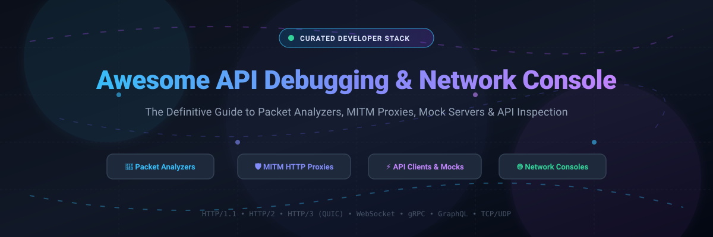

  

# 🚀 Awesome API Debugging & Network Console

  
  
  
  
  
  

  <b>A curated list of elite API debugging tools, HTTP/HTTPS man-in-the-middle (MITM) intercepting proxies, network packet analyzers, mock servers, and developer observability consoles.</b>

---

[📖 Sector Overview](#-sector-overview--market-dynamics) •
[💼 Commercial & SaaS Products](#-commercial--saas-products) •
[🔓 Open Source & Community Tooling](#-open-source--community-tooling) •
[⭐ Star History](#-star-history) •
[💖 Support & Sponsorship](#-support)

---

## 📊 Sector Overview & Market Dynamics

The global API management and developer observability tooling market is valued at approximately **$8.8B to $10.0B** (projected to reach over $13.5B by 2026 at a ~20–30% CAGR). The broader sector is **moderately concentrated at the enterprise infrastructure and gateway tier** (dominated by hyperscalers and platforms like Google Apigee, Kong, Postman, and MuleSoft), while remaining **highly fragmented at the developer debugging, local proxy, and network inspection tier**, where an active ecosystem of specialized commercial utilities, bootstrapped micro-ISVs, and community open-source projects co-exist.

---

## 💼 Commercial & SaaS Products

The table below covers the commercial and SaaS tools across the API debugging, proxying, and network console landscape. Sorted descending by company size (valuation / revenue).

| Product | Company / Parent | Company Size (Valuation / Revenue) | Starting Pricing (Paid Tier) | Free Tier Limits / Trial Limits | Description |
| :--- | :--- | :--- | :--- | :--- | :--- |
| **Postman Console** | Postman Inc. | **$5.6B valuation** (~$300M ARR) | $9/user/month (Solo, billed annually) or $19/user/month (Team) | **Free forever plan:** 1 user workspace, core API testing/debugging, 50 AI credits, 1,000 Context Graph queries/mo; collaboration restricted | Collaborative API design, testing, mock servers, and in-console network request inspection. |
| **Requestly** | BrowserStack *(acquired)* | **$4.0B valuation** (~$225M–$300M Parent ARR) | $12/user/month (Lite, billed annually) or $25/user/month (Pro) | **Free forever plan:** 1 user, essential HTTP rule creation, header modification, and redirect rules with capped mock data / shared lists | Chrome extension and desktop proxy for intercepting, modifying, and redirecting HTTP requests without network proxies. |
| **Insomnia** | Kong Inc. | **$2.0B valuation** (~$100M+ ARR) | $10/user/month (Pro, billed annually) | **Free forever plan:** Up to 3 users for Git Sync projects, unlimited cloud/local projects, 1,000 mock requests/mo, local offline Scratch Pad | Streamlined REST, GraphQL, and gRPC client with built-in network traffic inspection and environment sync. |
| **Fiddler Everywhere** | Progress Software *(NASDAQ: PRGS)* | **$1.8B market cap** (~$1.0B Parent Revenue) | $12/user/month (Pro, billed annually) or $18/month (billed monthly) | **10-day free trial:** Fully functional with unrestricted enterprise features, rule sets, and cloud captures; requires paid plan upon expiration | Modern cross-platform web debugging proxy for macOS, Windows, and Linux with traffic inspection and composition. |
| **Proxyman** | Proxyman LLC | **~$900K ARR** (Bootstrapped indie ISV) | $89–$99 one-time perpetual license (includes 1 year of updates) | **Free forever tier:** Single user, restricted to 1 active debugging rule (SSL Proxying/Map Local/Breakpoints) and 2 pinned domains; commercial trial limited to 14 days | Native, high-performance macOS/Windows/Linux HTTP/HTTPS debugging proxy with scriptable rule sets and iOS/Android companion apps. |
| **Charles Proxy** | XK72 Ltd. | Bootstrapped ISV / Micro-business *(Private, not disclosed)* | $50 one-time perpetual license (single seat; volume/multi-site discounts available) | **30-day free trial:** Fully featured; post-trial unlicensed sessions automatically terminate and force-quit after 30 minutes of continuous use | Classical cross-platform Java-based HTTP proxy, reverse proxy, and bandwidth throttling tool. |

---

## 🔓 Open Source & Community Tooling

A comprehensive directory of open-source API debugging, packet inspection, HTTP/HTTPS proxies, and network analysis tools. Sorted descending by GitHub star count.

| Project | Stars | Primary Focus / Protocol | Description |
| :--- | :--- | :--- | :--- |
| **[Hoppscotch](https://github.com/hoppscotch/hoppscotch)** |  | API Client & Testing (Web/Desktop) | Open-source, lightweight API development ecosystem (REST, GraphQL, WebSocket, SSE, MQTT, Socket.IO) built with high performance and accessibility in mind. |
| **[mkcert](https://github.com/FiloSottile/mkcert)** |  | Local SSL/TLS Certificate Tool | Zero-config tool to make locally trusted development certificates with its own CA, crucial for SSL/HTTPS proxy debugging and local HTTPS testing. |
| **[Bruno](https://github.com/usebruno/bruno)** |  | Offline-First API Client | Fast, Git-friendly, fully offline open-source desktop API client that saves collections directly in local directory folders using Bru markup language. |
| **[mitmproxy](https://github.com/mitmproxy/mitmproxy)** |  | Interactive MITM HTTP/S Proxy | Versatile, scriptable interactive TLS-capable intercepting HTTP proxy for HTTP/1, HTTP/2, HTTP/3, and WebSockets with CLI, web (`mitmweb`), and Python scripting interfaces. |
| **[curl](https://github.com/curl/curl)** |  | Command-Line Network Transfer | Universal, robust CLI utility and library for transferring data using HTTP, HTTPS, FTP, FTPS, SFTP, and 25+ other protocols, essential for low-level API debugging and header tracing. |
| **[Insomnia](https://github.com/Kong/insomnia)** |  | Open-Source API Design & Debugger | Intuitive desktop API design client and GraphQL/REST inspector with local-first storage, Git synchronisation, and plugin extensions. |
| **[k6](https://github.com/grafana/k6)** |  | Load Testing & API Performance | Modern, developer-centric open-source load and performance testing tool written in Go with JavaScript test scripting to evaluate API network limits and latency. |
| **[Vegeta](https://github.com/tsenart/vegeta)** |  | HTTP Load & Benchmarking Tool | Versatile HTTP load testing tool and library designed to drill HTTP services at constant request rates for pinpointing API latency degradation under network pressure. |
| **[ZAP (OWASP Zed Attack Proxy)](https://github.com/zaproxy/zaproxy)** |  | Security Proxy & Vulnerability Scanner | World's most widely used web application security intercepting proxy for active/passive API inspection, fuzzing, and vulnerability testing. |
| **[Whistle](https://github.com/avwo/whistle)** |  | Node.js Multi-Platform Web Debugger | Cross-platform web debugging proxy based on Node.js supporting HTTP, HTTPS, WebSocket, TCP packet capture, mock rules, and hosts mapping. |
| **[Wireshark](https://github.com/wireshark/wireshark)** |  | Deep Packet Protocol Dissector | The gold standard network packet analyzer that allows microscopic inspection of hundreds of network and transport protocols in real time. |
| **[Mockoon](https://github.com/mockoon/mockoon)** |  | Local API Mocking Tool | Complete local mock server application and CLI for quick API simulation, custom responses, rule-based routing, latency injection, and offline development. |
| **[Requestly](https://github.com/requestly/requestly)** |  | In-Browser HTTP Interceptor | Open-source browser extension and desktop tool to redirect URLs, modify request/response headers, mock API endpoints, and insert custom scripts. |
| **[kcat (kafkacat)](https://github.com/edenhill/kcat)** |  | Kafka & Event Stream Debugger | Generic non-JVM Apache Kafka producer and consumer utility acting like netcat for Kafka message buses, real-time message tracing, and topic debugging. |
| **[HTTP Toolkit](https://github.com/httptoolkit/httptoolkit)** |  | Targeted HTTP Debugging Proxy | Beautiful open-source intercepting proxy for inspecting, debugging, and mocking HTTP(S) traffic from browsers, Android, Node.js, Python, and Docker with 1-click setup. |

---

## 📈 Star History

---

## 💖 Support

A massive **thank you** to all contributors, developers, and open-source maintainers who build and support tools that keep our networks observable and debuggable! 🙌

If you found this curated list helpful, please consider:
- ⭐ **Starring this repository** to help others discover it
- 🍴 **Forking and sharing** it with your developer community
- ☕ **Sponsoring or buying a coffee** via the [GitHub Sponsor Dashboard](https://github.com/sponsors/ishandutta2007) to help support further open-source research and maintenance!

---

  Maintained with ❤️ by <a href="https://github.com/ishandutta2007">Ishan Dutta</a> • Contributions and pull requests are always welcome!

